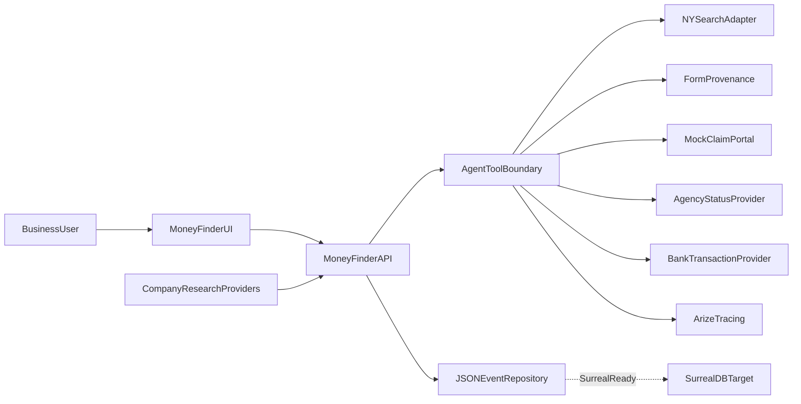
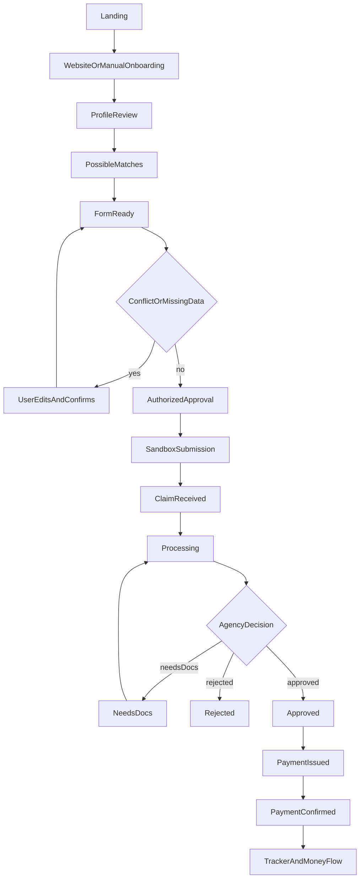
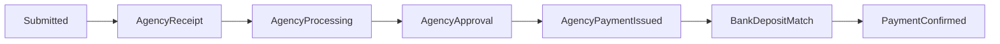

# MoneyFinder System Architecture

MoneyFinder is a business-first workflow for finding possible New York unclaimed funds, preparing claim forms with field-level provenance, requiring authorized approval, submitting through a sandbox portal, and tracking agency evidence separately from bank confirmation.

The current demo is intentionally synthetic. The runnable claim journey is JSON-backed and shaped for the SurrealDB schema; it does not claim to persist live claims in SurrealDB.

## System context



## Runtime modes

MoneyFinder has two product surfaces:

| Path | Look | Job |
|---|---|---|
| **Send** | Green Flask shell (Gmail + Wallet) | Research → opportunities → form review → approve → fill (never auto-submit) |
| **Track** | Blue claim-path UI (`ui/domain.html`) | Possible funds → claim-path progress → agency vs bank evidence |

### Send path (Gmail + Wallet)

```text
Browser
  ↓
research/business Flask app (make demo / make business-serve)
  ├─ Gmail OAuth (read-only)
  ├─ Company research + dossier
  ├─ Opportunity Wallet (/businesses/<id>/wallet)
  │    ├─ unclaimed search (imported or demo adapter)
  │    ├─ tax-credit matches from dossier
  │    ├─ Form review + immutable approval snapshot
  │    ├─ Form jobs (business-scoped fill status)
  │    └─ browser fill job (simulate or Anchor; never auto-submit)
  ├─ Track mount: /track/ → ui/domain.html
  ├─ Track API: /api/* → src.server.dispatch_api (same process)
  └─ per-business JSON under research/business/data/<id>/
```

Start:

```bash
make demo
# http://localhost:8000 → Sign in with Google → Open Wallet (Send)
# http://localhost:8000/track/ → Track (domain.html + /api/* on the same port)
```

### Track path (claim status + money evidence)

```text
Browser → ui/domain.html → /api/* (dispatch_api) → data/moneyfinder-events.json
```

Same UI and API are available two ways:

```bash
# Preferred: Send + Track together
make demo
# http://localhost:8000/track/

# Track-only process (optional)
python3 -m src.server   # or: make api
# http://localhost:4173
```

The deterministic fixture is [`fixtures/demo-seed.json`](../fixtures/demo-seed.json). The UI can reload it through `POST /api/demo/reset`. `/unclaimed/` redirects to `/track/`. Optional marketing landing: `/track/landing` (`ui/index.html`).

### Configured provider mode

The same API boundary can use configured adapters:

- Set `NY_UNCLAIMED_DATA_FILE` to use imported unclaimed-funds data instead of the mock corpus.
- Set `COMPANY_RESEARCH_LIVE=1` to use the company-research package and configured provider credentials.
- Bedrock is optional. Deterministic tools enforce the approval and evidence gates even when model reasoning is available.
- Arize tracing is optional and must not be treated as the source of claim status.
- Live SurrealDB is a future persistence implementation; the current claim runtime uses JSON.

## Component responsibilities

| Component | Location | Responsibility |
|---|---|---|
| Send UI | Flask templates under [`research/business/.../web/`](../research/business/src/business_research/web/) | Gmail connect, Opportunity Wallet, form review/approval, fill jobs |
| Track UI | [`ui/domain.html`](../ui/domain.html) | Possible funds, claim-path tracker, claim detail, money flow, agent-memory views |
| Track HTTP API | [`src/server.py`](../src/server.py) | Serves Track UI and exposes research, search, claims, forms, events, tracker, reset, and status-advance endpoints |
| Agent orchestration | [`src/agent/orchestrator.py`](../src/agent/orchestrator.py) | Coordinates deterministic tools and optional Bedrock tracing |
| Agent tools | [`src/agent/tools.py`](../src/agent/tools.py) | Search, form preparation, approval checks, portal submission, agency polling, bank matching, and transition validation |
| Search | [`src/search/`](../src/search/) | Mock and imported NY unclaimed-funds adapters |
| Form provenance | [`src/forms/provenance.py`](../src/forms/provenance.py) | Field sources, confidence, conflicts, validation, immutable form hashes, and browser read-back comparison |
| Status machine | [`src/pipeline/status.py`](../src/pipeline/status.py) | Canonical statuses, legal transitions, and evidence requirements |
| Persistence | [`src/persistence.py`](../src/persistence.py) | JSON claim projection, append-only events, evidence, forms, and agent-memory trail |
| Synthetic seed | [`fixtures/demo-seed.json`](../fixtures/demo-seed.json) | Repeatable Example NYC Foods LLC demo data |
| Mock portal | [`mock_portal/index.html`](../mock_portal/index.html) | Synthetic browser submission target |
| Providers | [`src/providers/`](../src/providers/) | Mock agency status and bank transaction providers |
| Target database schema | [`schemas/surreal/schema.surql`](../schemas/surreal/schema.surql) | Intended business, fact, claim, form-field, pipeline-event, evidence, and evaluation schema |

## Primary user journey



The UI uses the project-management reference for claim cards, progress bars, activity feed, and list/grid structure. It uses the thermometer reference for the status-progress bar and the money-counter reference for qualified possible-funds amounts.

## API surface

### Read endpoints

| Endpoint | Purpose |
|---|---|
| `GET /api/health` | Reports demo data source, persistence mode, and live-Surreal flag |
| `GET /api/tracker` | Returns summary metrics, claim cards, events, evidence, memory trail, and recent profiles |
| `GET /api/claims` | Lists persisted claims |
| `GET /api/claims/:claim_id` | Returns a claim bundle: claim, form, events, evidence, and memory trail |
| `GET /api/events?claim_id=...` | Returns append-only events, optionally filtered by claim |

### Workflow endpoints

| Endpoint | Purpose |
|---|---|
| `POST /api/research` | Builds a business research profile |
| `POST /api/profile/review` | Validates consent and saves the reviewed business profile |
| `POST /api/search` | Searches the configured or synthetic NY adapter |
| `POST /api/claims` | Creates a claim from a selected match |
| `POST /api/forms/prepare` | Creates a provenance-aware draft form |
| `POST /api/forms/save` | Saves edited fields and recalculates validation/hash |
| `POST /api/forms/approve` | Requires a valid form and authorized user approval |
| `POST /api/claims/submit` | Performs the mock portal read-back and records submission/receipt evidence |
| `POST /api/claims/advance` | Advances the agency rail, creates needs-docs/rejection states, or confirms a bank deposit |
| `POST /api/demo/reset` | Restores the deterministic synthetic fixture |

## Claim and evidence model

Each claim has:

- Stable `claim_id`
- Business identity and selected match
- Property type, city, ZIP, amount, amount type, and confidence
- Current status projection
- Confirmation ID when the agency has received the claim
- Approved form hash
- Timestamps for submission, approval, payment issued, payment confirmed, and last check
- Next action for the tracker
- Explicit `demo_only` marker for synthetic data

Each form field records:

- Field name and value
- Source
- Confidence
- Whether user confirmation is required
- Conflicting value and conflict source
- Whether the user edited the value

Each pipeline event records:

- Claim ID
- Previous and new status
- Actor
- Evidence kind and evidence ID
- Source/provider
- Reference or confirmation ID
- Note
- UTC timestamp

The JSON repository mirrors the Surreal target entities:

```text
business
fact
claim
form_field
pipeline_event
evidence
eval_trace
```

The current JSON `forms`, `claims`, `events`, `evidence`, and `memory_trail` collections are a local read/write projection of that target model.

## Status and evidence rules

Canonical status order:

```text
MATCH_FOUND
FORM_READY
USER_APPROVED
SUBMITTED
CLAIM_RECEIVED
PROCESSING
NEEDS_DOCS
APPROVED
PAYMENT_ISSUED
PAYMENT_CONFIRMED
REJECTED
STOPPED_BY_USER
```

Required evidence:

| Transition target | Required evidence |
|---|---|
| `SUBMITTED` | `submission` |
| `CLAIM_RECEIVED` | `agency_receipt` |
| `APPROVED` | `agency_approval` |
| `PAYMENT_ISSUED` | `agency_payment_issued` |
| `PAYMENT_CONFIRMED` | `bank_deposit` |

The agency and bank rails are intentionally separate:



Forbidden inferences:

- Submission does not imply payment.
- Agency approval does not imply bank deposit.
- Elapsed time does not imply approval.
- An estimated or matched amount is not incoming money.

## Agent-memory value

The agent-memory panel makes the workflow inspectable rather than opaque. It exposes:

1. What business facts were remembered.
2. Which source and confidence supported each field.
3. Which conflicts were found.
4. What the user changed or confirmed.
5. Which evidence allowed a status transition.
6. Which next action the agent recommends.

Today this trail is stored in JSON and displayed in the UI. The SurrealDB schema is the future durable representation for facts, claims, form fields, pipeline events, evidence, and evaluation traces.

## Security and correctness boundaries

- User and provider values are escaped before UI interpolation.
- Forms cannot be approved while required fields or conflicts remain unresolved.
- Submission uses the approved field snapshot and performs browser read-back comparison.
- Status transitions are validated by [`src/pipeline/status.py`](../src/pipeline/status.py).
- Synthetic search, portal, agency, and bank data are labeled in the UI.
- State claims are free in the demo; the product must not imply legal, tax, or financial advice.
- API errors are shown as recoverable UI states rather than silently advancing the journey.

## Verification

Run the deterministic checks:

```bash
python3 tests/test_pipeline.py
python3 tests/test_domain_api.py
python3 tests/test_journey_api.py -v
```

The journey test covers:

- Seeded tracker loading
- Form conflicts blocking approval
- Full approval → submission → agency → bank progression
- Separate agency and bank evidence
- Rejection and needs-docs states
- Illegal transition blocking

For a visual check, start `make demo` (or `make api`) and open:

```text
http://localhost:8000/track/#landing
http://localhost:8000/track/#tracker
http://localhost:8000/track/#claim/claim_demo_vendor_check
http://localhost:8000/track/#memory
# Track-only equivalent: http://localhost:4173/#…
```

## Known implementation boundary

The current implementation is a production-shaped synthetic demo, not a production claims service. In particular:

- `JsonEventRepository` is the active persistence layer.
- `MockNYUnclaimedAdapter` is the default search source.
- `MockAgencyStatusProvider` is the default agency source.
- `MockBankTransactionProvider` emits synthetic deposits.
- The claim UI is served as a single static HTML application.
- Live SurrealDB persistence, live agency polling, and real bank adapters remain future integrations behind the existing boundaries.
