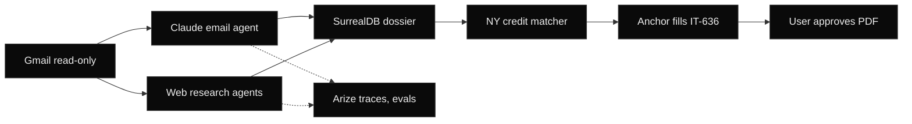

1. Business email + Gmail (read-only) -> in parallel: Claude email agent on Bedrock (EIN, barrels, license) and web research agents (Firecrawl, NY DOS, NYC Open Data, news, LinkedIn).
2. Both feed a SurrealDB Cloud dossier (facts with provenance) -> credit matcher ranks niche NY credits (forms from tax.ny.gov, irs.gov).
3. Anchor Browser fills NY Form IT-636 live, reads every field back, never submits -> user reviews and approves. Arize traces and evals throughout.
