# Business Tax Credit Discovery and Refund-Recovery Services: U.S. Provider Landscape

*Research current through October 16, 2026. The comparison emphasizes primary sources: IRS guidance, company service descriptions, published provider case studies, and official company materials. Dollar outcomes reported by providers are identified as case studies or vendor claims rather than statistically representative results.*

## Executive summary

A substantial market exists for firms and software platforms that inspect a company’s **operating data—not merely its filed tax returns—to uncover tax credits, accelerated deductions, overpaid taxes, and refund claims**. The strongest offerings generally fall into four models: specialist tax consultancies such as KBKG, Engineered Tax Services, Tri-Merit, alliant, and Leyton; broad enterprise tax-recovery firms such as Ryan; embedded payroll/employment-tax platforms such as ADP SmartCompliance; and tax-incentive discovery software such as Incentify. These models should not be evaluated as interchangeable because the data they analyze, the tax opportunities they pursue, and who assumes responsibility for substantiation are materially different. citeturn22view2turn20search0turn17search0turn12search1turn17search3

The most common opportunities found from internal operations are **R&D credits under IRC §41, cost-segregation/accelerated depreciation, WOTC and other employment credits, state and local incentives, sales/use-tax overpayment recoveries, energy incentives, and property-tax opportunities**. For R&D, providers typically combine payroll and general-ledger data with interviews of engineers, software developers, scientists, production managers, or other technical personnel and then map projects and expenses to the statutory qualification tests. Cost-segregation providers instead examine construction documents, fixed-asset data, invoices and the physical property; the IRS's own Cost Segregation Audit Technique Guide describes a detailed engineering approach using contemporaneous construction/accounting records and property inspections. citeturn20search0turn1search12turn15view0turn14view1

One critical distinction is that **“refund” is not a uniform metric**. An amended R&D claim may produce a cash refund; WOTC lowers income-tax liability; a sales/use-tax recovery review may produce a state refund; and cost segregation normally accelerates depreciation deductions and cash flow rather than creating a tax credit. Consequently, a provider advertising “$500,000 of tax benefit” may be describing something economically different from another provider advertising a $500,000 refund. Cost-segregation proposals should therefore be compared on present-value cash flow, tax rate, holding period and recapture assumptions—not simply gross deductions. citeturn22view1turn15view0

Public pricing is surprisingly scarce. Among the providers reviewed, **KBKG publishes approximately $5,000–$15,000 for conventional cost-segregation studies and offers software-based studies starting around $495; Engineered Tax Services publishes approximately $3,000–$12,000 for cost segregation; Incentify publicly lists software tiers including Free, $275, $450 and custom Enterprise pricing; most providers do not publish R&D-study fees or contingency percentages.** KBKG says a conventional cost-segregation study usually takes 45–60 days; ETS says roughly 4–6 weeks. citeturn22view3turn10search12turn8search0turn22view0

The biggest diligence issue is **claim defensibility rather than headline savings**. For amended §41 research-credit refund claims, the IRS maintains special substantiation requirements, with transition rules currently extending through January 10, 2027; ordinary refund limitations also generally require a claim within three years of filing the original return or two years from payment, whichever is later, subject to exceptions. The IRS Cost Segregation Audit Technique Guide tells examiners to scrutinize cost-segregation studies for methodology, supporting documentation and fee arrangements, specifically warning that contingent compensation can create incentives for aggressive classification. citeturn0search0turn0search24turn16view0

A separate caution applies to **Employee Retention Credit consulting**. ERC should no longer be treated as an ordinary greenfield “credit discovery” opportunity. The IRS continues to warn businesses about promoters promising quick eligibility determinations or charging fees tied to the size of the ERC refund, and 2025 legislation imposed additional restrictions on late claims for portions of 2021. A provider whose 2026 sales pitch is dominated by easy ERC refunds deserves substantially more scrutiny than one focused on current R&D, employment, property, SALT and incentive programs. citeturn0search2turn0search6turn0search14

**Best-fit conclusions from the research:** Ryan is the most compelling candidate here for a large, multistate enterprise seeking broad tax-recovery and ongoing tax-technology capabilities; KBKG, ETS, Tri-Merit and Leyton are particularly comparable for specialty-tax work spanning R&D and real-estate incentives; alliant is strongly oriented toward R&D and complex credit work; ADP is differentiated where payroll and high-volume hiring are central to the opportunity; and Incentify is best viewed as a discovery/governance layer rather than a substitute for a tax preparer or engineering study. These are fit judgments based on the documented service models, not a ranking of claim quality. citeturn5view0turn22view2turn8search0turn20search19turn19search4turn20search0turn12search0turn17search3

## What these services actually do

A serious tax-opportunity review is usually broader than asking the controller “do we perform R&D?” Providers may analyze payroll records, the general ledger, accounts payable, fixed-asset ledgers, capital expenditures, construction contracts, project-management records, employee locations, hiring records, property addresses and technical project documentation. The objective is to map ordinary operating activity onto tax provisions that finance, engineering, HR or operations teams may never have identified as tax-sensitive. KBKG, for example, lists payroll records, receipts, blueprints, prototypes and meeting records among useful R&D substantiation; Tri-Merit describes engaging relevant personnel and departments while obtaining reports and records; ETS's cost-segregation process uses purchase/construction records and property inspection; and Incentify can match locations and entities to more than 1,200 federal, state and zone incentive programs. citeturn10search29turn1search12turn8search0turn17search3

The workflow typically resembles the following:

```mermaid
flowchart LR
    A[Operational data scan<br/>GL, payroll, AP, fixed assets,<br/>projects, hiring, locations] --> B[Opportunity mapping<br/>R&D, WOTC, cost segregation,<br/>SALT, energy, local incentives]
    B --> C[Technical qualification<br/>interviews, engineering review,<br/>four-part tests, eligibility rules]
    C --> D[Substantiation<br/>invoices, time/project records,<br/>drawings, calculations, workpapers]
    D --> E[Quantification<br/>credit, deduction, refund<br/>or cash-flow model]
    E --> F[Claim or implementation<br/>return, amended return,<br/>certification, refund application]
    F --> G[Agency processing]
    G --> H[Audit defense / monitoring<br/>responses, document retention,<br/>deadlines and clawbacks]
```

That sequence is consistent with the IRS's expectations for evidence-intensive studies: its current cost-segregation guidance describes reviewing actual costs, drawings, specifications, contracts, invoices, physical assets and classifications, while §41 amended-return claims have their own substantiation requirements. citeturn14view1turn0search0

### R&D credit studies

R&D specialists usually begin by identifying business components or projects and technical uncertainty, then interview personnel responsible for experimentation, connect those activities to qualified research expenses, and quantify wage, supply, cloud/software and qualifying contract-research costs. alliant, for example, identifies those QRE categories and describes documentation such as employee time records, design documentation, testing reports and financial records; Tri-Merit describes interviewing relevant personnel and gathering technical documentation. citeturn20search0turn1search12

For qualified small businesses, the federal research credit can also interact with payroll taxes; the IRS currently describes the qualified-small-business payroll-tax election on its research-credit guidance, and the maximum payroll-tax credit can reach $500,000 under current rules. citeturn0search20turn0search8

### Cost segregation and fixed-asset reviews

These studies are fundamentally engineering/accounting exercises rather than “credit searches.” The IRS lists multiple methods, including detailed engineering using actual costs, engineering cost estimates, survey/letter techniques, residual estimation, sampling/modeling and rule-of-thumb approaches. The detailed actual-cost method relies on contemporaneous construction/accounting records and is described by the IRS as especially methodical and accurate when those records exist. citeturn14view1turn15view0

A stronger provider will normally reconcile costs, determine asset function, allocate direct and indirect expenses, assign appropriate depreciation classifications, and give the client's CPA sufficient schedules and workpapers to implement the result. The IRS specifically tells examiners to evaluate methodology, cost-allocation sources and contemporaneous documentation. citeturn16view0

### Employment and location-based incentives

Here software integration matters more. ADP's WOTC workflow can screen applicants during hiring, collect eligibility information electronically and support the state certification process; it emphasizes the statutory requirement to submit the relevant certification materials to the state workforce agency within 28 days of the employee's start date. Incentify takes a different approach, matching addresses, entities and operational facts against a large incentives database and monitoring deadlines and clawbacks. citeturn12search0turn17search3

### Recovery audits and ongoing tax management

Enterprise firms such as Ryan extend the model into recurring indirect-tax and compliance reviews. Ryan describes tax technology that ingests company data, automates calculations and helps identify refund/overpayment opportunities, alongside managed tax services and one-time recovery reviews. That makes it materially different from a specialist hired solely to prepare one R&D or cost-segregation study. citeturn5view0turn4search26turn6search19

## Comparative provider table

**How to read the “refund/ROI” column:** there is no reliable public dataset establishing a true average refund by provider. I therefore distinguish provider-stated averages from **published individual case studies**, which are inherently selection-biased and should not be used as expected values.

| Company name | Headquarters | Services offered | Methodology | Fee model | Typical refund range/ROI | Timeline | Industries | Compliance notes | Link to source |
|---|---|---|---|---|---|---|---|---|---|
| **KBKG** | Pasadena, California is a major/principal firm location; nationwide U.S. team | R&D credit; cost segregation; §179D; §45L; repair-vs-capitalization; state/location incentives; transfer pricing; IC-DISC; fixed-asset tools | R&D uses financial/project evidence and technical analysis; cost seg reviews contractor payments, invoices, change orders, depreciation schedules, appraisals, inspections/interviews; also offers software | Conventional cost seg **$5,000–$15,000**; self-service cost-seg software starts about **$495/report**; R&D pricing not publicly disclosed | No statistically published “typical.” NY pharmaceutical case: **$361,666 federal + $42,000 NY** R&D credit; other cases include smaller firms | Cost seg typically **45–60 days** once information is received | Software, pharma, manufacturing, A&E, real estate, hotels, healthcare, restaurants, retail, oil/gas, financial services and many others | Offers R&D audit-defense capability; conventional studies stress detailed documentation and qualified specialists | [Cost-seg FAQ](https://www.kbkg.com/costsegregation/faq) · [R&D case study](https://www.kbkg.com/rd-tax-credit-case-study/new-york) citeturn22view3turn21search1turn10search12turn22view2 |
| **Engineered Tax Services / ETS** | West Palm Beach, Florida | Cost segregation; R&D tax credit; energy incentives and specialty tax/engineering services | Cost seg uses engineering analysis, purchase/construction documents, depreciation schedules, renovation data and generally physical inspection; deliverable includes component-level schedules and supporting documentation | Cost seg commonly published at about **$3,000–$12,000**; R&D pricing not publicly disclosed | ETS states cost-seg ROI often averages **10:1 or better**; published R&D examples include an AI/cloud software client with about **$294,000** savings and other cases from ~$75k to >$500k | Cost seg typically **4–6 weeks** | Real estate, manufacturing, software, architecture, engineering and other innovation-heavy sectors | Markets audit-ready studies and audit-defense support; engineering substantiation is a core differentiator | [Official site](https://engineeredtaxservices.com/) citeturn8search0turn8search7turn9search4turn9search7turn9search26 |
| **Tri-Merit Specialty Tax Professionals** | Schaumburg, Illinois | R&D credit; cost segregation; §179D/§45L and other specialty incentives; audit defense | No-cost feasibility review; R&D consultants interview personnel and gather activity/financial evidence; cost seg uses engineering-based allocation of direct/indirect costs and MACRS lives | **Free feasibility analysis**; fee charged if client proceeds; exact study pricing/percentage not publicly published | $5m software-company R&D case reported **>$700,000** federal/state tax savings over two years. For cost seg, Tri-Merit models roughly **$45k–$140k of years 1–5 cash-flow improvement per $1m basis**, depending on property type and stated assumptions | No standardized public R&D SLA found; scope-dependent | Software, manufacturing, engineering, real estate, hospitality, healthcare, retail, data centers and other SMB/midmarket sectors | Audit-defense services are included for its specialty-tax work; coordinates with client's CPA; emphasizes audit-ready engineering methodology | [Cost segregation](https://tri-merit.com/services/cost-segregation/) citeturn11search1turn1search3turn1search12turn1search9turn20search19turn22view1 |
| **alliant / alliantgroup** | Houston, Texas | R&D credits; §179D; investment tax credit; IC-DISC; tax controversy and broader advisory/managed services | Identifies qualified activities and QREs through technical and financial analysis; focuses on wages, supplies, cloud/software and qualifying contract research plus project documentation | Pricing not publicly disclosed on reviewed primary pages | No public statistical average. Current R&D page highlights a published client example of **$6,088,597 federal + state credits** | No standardized public turnaround found | Aerospace, agriculture, automotive, building controls, chemical, engineering, food/beverage, life sciences, manufacturing, metals, oil/gas, software | Says it works with 4,500+ CPA firms; current R&D guidance emphasizes project-level documentation and Form 6765 requirements | [R&D tax credit](https://www.alliantgroup.com/services/r-d-tax-credit-2/) citeturn17search2turn20search0turn2search20 |
| **Ryan, LLC** | Plano, Texas, global headquarters | Credits/incentives; income and employment tax; indirect-tax recovery; property tax; unclaimed property; managed services; tax technology; specialty tax | Large-scale data extraction/analytics, tax calculations, transaction review, consultant analysis and representation before tax authorities; can combine one-time recovery reviews with ongoing managed services/software | U.S. pricing not publicly posted on reviewed pages; model varies by service/project | No comparable individual “typical refund” published. Ryan states **>$60B in annual tax savings worldwide** across its broad business; that is a firm-wide marketing metric, not an expected client refund | One-time projects plus ongoing managed-services arrangements; no universal SLA | Broad enterprise coverage across multinational, multistate and transaction-intensive businesses | Particularly relevant where refunds depend on transaction populations and tax-authority interaction; ask for service-specific workpapers, fee structure and audit representation | [Ryan](https://ryan.com/) · [Plano/Dallas locations](https://ryan.com/who-we-are/find-an-office/dallas) citeturn18search3turn5view0turn4search26turn6search19 |
| **Leyton USA** *(global firm)* | Global company with U.S. operations; U.S. offices include Boston, New York, San Francisco-area and Phoenix | Federal/state R&D credits; cost segregation; real-estate tax optimization; grants; SALT; sales/use tax; utility exemptions; global trade; energy incentives; ERC representation | Consultant-led technical review combined with technology; cost seg uses engineering/tax specialists and can be remote or in person; R&D work examines contracts, projects and technical/financial evidence | Cost seg: **no upfront retainer/payment; invoiced after delivery**; exact R&D pricing not publicly posted | Cost-seg marketing estimate: roughly **$30k–$80k savings per $1m building value over first five years**; wearable-tech R&D case reported **$822,265** credits | No standardized public turnaround found | Technology/software, manufacturing, A&E, food/beverage, life sciences, real estate and 70+ industries | Published studies emphasize technical substantiation; ERC work should nevertheless be evaluated against current IRS promoter warnings | [Leyton USA](https://leyton.com/us/) · [U.S. locations](https://leyton.com/us/locations/) citeturn19search1turn19search3turn7search6turn6search2turn6search14 |
| **ADP SmartCompliance Tax Credits** | Roseland, New Jersey | WOTC and employment-tax credits; R&D credit support; tax-credit screening integrated into payroll/HCM workflows | Digital applicant screening, conditional questionnaires, automated data capture, payroll/hours monitoring, analytics and specialist review; R&D offering adds specialist assessment of qualifying activity/expense | Quote-based commercial arrangement; public percentage/contingency pricing not disclosed | Andy Frain Services case: **>$1.1m of credits in two years**, 99% candidate screening and 26% identified as WOTC eligible. These are client-case results, not averages | WOTC screening happens in hiring workflow; certification documents generally must reach state agency within **28 days** of start date | Any size/industry can potentially use WOTC; especially valuable to employers with significant hiring volume | Major advantage is capturing eligibility at hiring rather than reconstructing it later; workflow directly addresses statutory certification deadlines | [ADP](https://www.adp.com/) citeturn12search0turn12search1turn12search24turn12search5 |
| **Incentify** | El Segundo, California | Software for tax-credit/incentive discovery, qualification assessment, portfolio management, filing/deadline tracking and compliance monitoring across 1,200+ programs | AI-based eligibility matching; address/entity analysis; program-value estimates; filing instructions; zone mapping; deadline/clawback monitoring; APIs and advisor/client workflow | **SaaS.** Pricing page displays Free, **$275 Starter**, **$450 Pro**, and custom Enterprise tiers, with monthly/annual options; verify current billing basis in quote | Does **not** publish a comparable refund average; says **$20B+ credits/incentives are managed** on the platform, which is portfolio value, not a realized-refund metric | AI-guided eligibility/value assessment can occur **in minutes**; claim filing/monetization depends on the underlying program | Enterprises, advisers, franchises and businesses of various sizes | Strong discovery/governance tool, but eligibility software does not itself replace legal/tax substantiation, engineering work or return preparation where those are required | [Explore & pricing](https://www.incentify.com/explore) citeturn17search3turn22view0turn13search3turn17search26 |

The public pricing gap itself is material. For R&D studies in particular, most reviewed providers require a feasibility call before giving a quote. That means a competitive procurement should ask all finalists to price the **same fact pattern and the same scope of work**, including amended years, states, audit support and workpaper delivery, rather than comparing percentages or quoted fees in isolation. citeturn1search3turn21search1turn20search0

## Detailed provider profiles

**KBKG — strong specialty-tax benchmark, particularly for R&D plus real estate.** KBKG has one of the more transparent public cost-segregation offerings in this group. Its conventional methodology reviews contractor payment applications, invoices, change orders, depreciation schedules, appraisals and other property records and may use inspections/interviews; the firm says a study commonly takes 45–60 days and generally costs $5,000–$15,000. It also has a software pathway through CostSegregation.com beginning around $495 per report, creating an unusual spectrum from self-service to consultant-led work. citeturn22view3turn10search12

For R&D, KBKG combines technical tax analysis with payroll/financial and project-level documentation. Its published New York pharmaceutical case covered 2017–2020 and reported $361,666 in federal research credits plus $42,000 from New York. A New Jersey engineering example involved a company with fewer than 30 employees and reported $211,166 federal plus $100,000 state credit, illustrating that its target market is not confined to large enterprises. citeturn21search1turn1search7

There is no public R&D minimum engagement size or standard fee schedule in the primary materials reviewed. The sub-30-person case and self-service cost-seg product demonstrate that smaller clients can be economically viable, but a prospective client should obtain a written minimum fee and break-even estimate. KBKG also offers R&D audit-defense support, which should be scoped carefully—particularly what is included after an IRS Information Document Request, whether hours are capped, and who pays for appeals or outside counsel. citeturn1search28turn22view2

**Engineered Tax Services — engineering-intensive and unusually transparent on cost-seg economics.** ETS's most differentiated offering is its engineering-based cost-segregation process. It describes collecting acquisition/construction documents, drawings, depreciation schedules and renovation records, conducting site analysis, and producing component-level engineering support and depreciation schedules. Its published range is approximately $3,000–$12,000 with a typical 4–6 week completion period; the firm claims cost-segregation engagements frequently yield 10:1 or better ROI. That ROI is the provider's own figure and should be recalculated from the client's tax rate, holding period and incremental present-value cash savings. citeturn8search0

ETS also operates an R&D practice. A published AI/cloud-software case reported approximately $294,000 of tax savings, while other published examples include $541,379 for a civil-engineering/architecture company and smaller five- and six-figure results in manufacturing and software. The studies describe qualified-expense analysis spanning employee wages, cloud costs and contract research. citeturn9search4turn9search7turn9search10

For R&D, ETS itself describes a frequently attractive profile as a manufacturer or similar business with roughly 10 or more employees and more than $1 million of revenue; that is a vendor screening heuristic, not a tax-law eligibility threshold. There is no publicly disclosed standard R&D fee schedule. citeturn9search5

**Tri-Merit — particularly attractive when the CPA wants a specialty-tax back office rather than a replacement tax firm.** Tri-Merit explicitly positions itself around specialty work performed with CPAs, CFOs and business owners. Its R&D approach begins with a no-cost feasibility analysis, after which there is a fee only if the company proceeds with a study; public primary materials reviewed here do not disclose a universal percentage or fixed-dollar schedule. Consultants engage relevant employees and departments and gather both financial and technical evidence. citeturn1search3turn1search12turn20search21

Its published $5 million software-company case is useful because it provides context instead of just a percentage claim: Tri-Merit examined multiple software initiatives, qualified six customer projects and an internal development project, and reported more than $700,000 in federal and state tax savings over two years. Again, this is a selected case, not an average. citeturn1search9

Tri-Merit is especially explicit about audit support. It says audit-defense services accompany its specialty studies and can include responding to notices, preparing documentation and witnesses, and participating in auditor meetings. Its current cost-segregation materials describe a structured engineering allocation process and publish modeled years-1–5 cash-flow ranges per $1 million of property basis: for example roughly $90,000–$140,000 for manufacturing property, $55,000–$90,000 for garden-style multifamily and $45,000–$70,000 for a standalone restaurant under the assumptions shown on its site. citeturn20search19turn22view1

There is no numeric company-size minimum published. Tri-Merit's small/midsize positioning and free feasibility step make it a reasonable candidate for a midmarket company that needs to establish whether the benefit justifies a full study before committing. citeturn1search24

**alliant — deep R&D orientation and a strong fit where technical qualification is complex.** alliant's current R&D practice describes QRE analysis covering wages, supplies/materials, cloud/software costs and qualifying third-party research, along with the four-part qualification framework. It says it works with more than 4,500 CPA firms, suggesting a channel model in which the specialty adviser supports rather than necessarily replaces the return preparer. citeturn20search0

Its published current R&D page highlights a case yielding $6,088,597 in federal and state credits for work involving connector redesign, 3D modeling, prototypes, latching mechanisms and iterative experimentation. That example demonstrates the type of operational evidence a technical review may capture but should not be interpreted as a “typical” alliant engagement. citeturn20search0

Pricing, minimum engagement size and standard turnaround are not publicly stated on the reviewed primary pages. That makes commercial diligence especially important: obtain a fee schedule separating current-year compliance, lookback years, state calculations, amended returns, audit defense and any success-based component. alliant's headquarters is in Houston. citeturn17search2

**Ryan — the broadest enterprise recovery model in this comparison.** Ryan's value proposition differs from a pure credit-study shop. It spans credits and incentives, employment taxes, income tax, indirect tax, property tax, unclaimed property and managed tax services, supported by tax technology. Its official materials describe using proprietary technology to extract/analyze data, automate calculations and identify refund or overpayment opportunities, so Ryan is particularly relevant when the opportunity sits in large transaction populations—for example purchasing, sales/use tax, property portfolios or multijurisdictional operations—rather than a single §41 calculation. citeturn5view0turn6search19

Ryan supports both one-time recovery reviews and ongoing arrangements. Its company-wide claim of more than $60 billion in annual tax savings worldwide is a scale metric, not a typical client outcome and not equivalent to refunds. Its global headquarters is now in Plano, Texas. citeturn5view0turn18search3turn18search9

A useful official client reference is Workplace Resource: its CFO credited Ryan with improving tax processes and working with taxing authorities, saying the relationship had provided “outstanding value.” Ryan does not publish a universal U.S. fee schedule on the reviewed service pages, so enterprises should request fee terms by tax type; the economics of a recurring managed-service contract can be very different from a one-time recovery project. citeturn5view0

Ryan is best considered when a CFO wants a **broad tax leakage/recovery diagnostic across several tax types**, potentially followed by ongoing technology or managed services. For a narrow R&D-only assignment, specialist firms can be easier to compare directly.

**Leyton — broad incentives consulting with a useful blend of technical staff and commercial flexibility.** Leyton is an international consulting firm rather than a U.S.-headquartered specialist, but it has a substantial U.S. operation and offices including Boston, New York, the San Francisco area and Phoenix. Its U.S. portfolio includes federal and state R&D credits, cost segregation, commercial-real-estate incentives, SALT work, grants and other incentives. citeturn19search1turn19search3turn19search4

Its cost-segregation materials say studies are performed by engineering/tax specialists and can be handled through remote or in-person review; Leyton states no upfront retainer/payment is required for that product and invoices after delivery. It advertises estimated first-five-year savings of approximately $30,000–$80,000 per $1 million of building value and reports having conducted more than 10,000 studies with more than $500 million in tax savings. Those are provider marketing figures rather than independent benchmarks. citeturn7search6turn19search6

One of its useful published R&D references involves a wearable-technology manufacturer: Leyton examined the company's technical and contractual facts and reported $822,265 of R&D credits spanning several years. Another California software example reported roughly $370,000 of federal credits across 2022–2025. citeturn6search2turn6search20

Leyton's exact R&D pricing and minimum client size are not publicly standardized. Its cost-seg material includes small real-estate investors, while its broader U.S. practice spans many industries, so economic minimums appear to be service-specific rather than company-wide. citeturn7search6turn19search19

**ADP SmartCompliance — strongest where the tax opportunity is embedded in payroll and hiring.** ADP is not primarily a specialty-tax consulting boutique. Its advantage is that tax-credit identification can sit close to the HR/payroll data where eligibility arises. For WOTC, ADP's workflow can screen candidates electronically, collect relevant information, use conditional logic and monitor hiring/payroll data while supporting timely state certification. ADP states that WOTC can apply to businesses regardless of size or industry. citeturn12search0

The Andy Frain Services case provides unusually concrete operational metrics: ADP reports 99% candidate screening, 26% of candidates identified as WOTC-eligible and more than $1.1 million in credits over two years. Big 5 Sporting Goods is another published reference; the retailer moved from paper forms to an integrated digital workflow across hundreds of locations. citeturn12search24turn12search25

ADP also markets R&D tax-credit support in which specialists evaluate qualified activities and expenses. Pricing for SmartCompliance tax-credit work is not publicly itemized in the sources reviewed. There is no hard statutory or provider minimum for WOTC in ADP's materials, but the economics are particularly compelling for high-turnover or high-hiring-volume employers because automation prevents eligible hires from being lost to the 28-day certification deadline. citeturn12search1turn12search0

**Incentify — strongest as a discovery and governance platform, not as a substitute tax preparer.** Incentify is the outlier in the group. Rather than starting with a consultant manually deciding which credits to investigate, the platform maps company addresses, entities and operating characteristics across more than 1,200 federal, state and zone programs. Its AI Navigator can estimate values and display eligibility conditions, forms, deadlines and filing requirements; its Optimize product adds portfolio management, payment forecasting, compliance alerts and clawback monitoring. citeturn17search3turn13search3

That is potentially valuable for a multistate company because the problem is often not calculating a known credit but **discovering that an incentive exists at all**. The software also supports integrations/API workflows, making it suitable for internal tax departments, CPA firms and advisory organizations managing many locations or clients. citeturn13search5turn17search17

Its current public pricing is more transparent than most consultant-led firms: the Explore page displays a Free tier, $275 Starter, $450 Pro and custom Enterprise pricing and supports monthly/annual plan selection. Because the rendered page does not unambiguously associate the scraped dollar figures with one billing toggle, the billing cadence should be verified before contracting. citeturn22view0

Incentify says more than $20 billion of incentives are managed through the platform, and its published customer/reference material includes companies such as 3M, Cargill, Kroger, Tyson, Paramount and Wyndham. Neither figure establishes how much incremental tax savings the software alone created; a procurement team should ask for realized-credit case studies, not just assets or incentives “managed.” citeturn17search3turn17search26

## Compliance, economics, and risk considerations

### Documentation quality should outweigh the size of the preliminary estimate

For R&D, the safest engagement is one in which the provider can trace a claimed QRE from the tax calculation back to payroll or accounting records and can tie the employee/project activity to contemporaneous technical evidence. The IRS currently requires Form 6765 to calculate and claim the research credit and maintains enhanced information requirements for certain §41 refund claims on amended returns. citeturn0search8turn0search0

A provider that generates a large credit largely from percentage-of-time estimates developed years later should therefore be evaluated more skeptically than one that can integrate project-management records, time tracking, design files, testing records, payroll and interviews. That is an analytical conclusion from the IRS documentation framework and from the stronger providers' own described processes. citeturn20search0turn10search29turn1search12

### Cost segregation deserves its own diligence protocol

The IRS Cost Segregation Audit Technique Guide is unusually useful as a buyer's checklist. It tells examiners to examine the engagement letter, methodology, source of unit costs, actual-versus-estimated allocations and contemporaneous evidence. It also notes that many firms price studies based on project size while some use contingency fees, and warns that benefit-based contingency compensation can incentivize aggressive allocation of costs to shorter-lived property. citeturn16view0

That means a $10,000 fixed-fee engineering study can actually be economically safer than a “no-cost-unless-we-save-you-money” proposal, even when the latter initially sounds more aligned with the client.

A proposal should state whether the analysis uses actual construction costs, engineering estimates, modeling or another technique; which credentials the preparer has; whether a site visit occurs; whether the client receives the detailed asset schedule and workpapers; and exactly what audit defense includes. The IRS's preferred detailed approach uses contemporaneous construction/accounting evidence, drawings, specifications, contracts, change orders, vendor invoices and inspection data when available. citeturn14view1

### Contingency fees require tax-specific analysis

A success fee is not automatically evidence of poor work, but it can change incentives. For cost segregation, the IRS explicitly flags contingent compensation as a reason for closer scrutiny. citeturn16view0

For **ERC**, the warning is stronger: the IRS specifically identifies percentage-of-refund compensation among promoter warning signs and advises employers to avoid preparers basing ERC fees on the amount of the refund. It also warns against providers claiming they can establish eligibility in minutes or aggressively representing that virtually every employer qualifies. citeturn0search2turn0search6

For other refund claims, fee permissibility depends on the type of engagement and professional rules; commercial “contingency” terminology should therefore be reviewed by the company's tax counsel/CPA rather than generalized from one tax program. The important procurement question is not only **“What percentage do you charge?”** but also **“Does the fee calculation reward a larger tax position regardless of defensibility?”**

### Statutes and deadlines can destroy otherwise valid opportunities

For federal refund claims, the ordinary limitations framework generally requires the taxpayer to file within three years from the original return filing date or two years after the tax was paid, whichever period expires later, subject to exceptions. R&D amended-return claims have additional IRS information requirements. citeturn0search24turn0search0

WOTC presents a different problem: state certification is time-sensitive, typically requiring the applicable forms to be submitted within 28 days of a qualifying employee's start date. This is precisely why embedded workflows such as ADP's can outperform retrospective consulting for high-volume employers—the opportunity can expire before year-end tax planning begins. citeturn12search0

### “Audit defense included” needs to be defined contractually

Several specialty firms advertise audit support, including Tri-Merit, ETS and KBKG. But “audit defense” can mean anything from answering one information request to supplying a technical team throughout examination and appeals. Tri-Merit expressly lists responding to notices, preparing IRS documents and witnesses, and supporting meetings with auditors; that level of specificity is preferable to a generic promise to “stand behind the study.” citeturn20search19turn9search26turn1search28

The engagement letter should state whether audit support is included in the original fee, whether there is an hours cap, whether state audits are covered, whether appeals are covered, whether outside legal counsel is excluded, and whether the provider remains responsible after the engagement terminates.

### Security matters because these firms receive unusually sensitive data

A comprehensive tax-opportunity review can expose payroll, Social Security-related hiring information, R&D intellectual property, contracts, detailed general-ledger transactions and property records. A vendor therefore should be diligenced not only as a tax adviser but also as a privileged data processor. Ryan specifically emphasizes tax technology/data infrastructure, ADP is inherently integrated with payroll/HCM data, and Incentify offers cloud-based incentive-management software; the security-review burden is consequently meaningful for all three, albeit in different ways. citeturn6search19turn12search0turn17search14

Ask for the current SOC report or equivalent controls documentation, penetration-testing program, encryption/data-retention terms, subprocessors, breach-notification language and whether customer data may be used to train AI models. Those are procurement recommendations rather than claims about deficiencies at any provider.

### Provider case studies are useful but are not expected-value statistics

The published results in this report range from five-figure credits to multi-million-dollar cases. That variation reflects differences in eligible payroll, open tax years, state regimes, property basis, hiring volume and business activity—not simply provider skill. KBKG's $403,666 combined New York case, ETS's $294,000 software case, Tri-Merit's >$700,000 software example, alliant's $6.09 million example, Leyton's $822,265 case and ADP's >$1.1 million employment-credit case are all self-published selected examples. citeturn21search1turn9search4turn1search9turn20search0turn6search2turn12search24

A more meaningful ROI formula is:

\[
\text{Net ROI}
=
\frac{
\text{present value of realized tax benefit}
-
\text{provider fees}
-
\text{internal labor}
-
\text{incremental compliance/audit cost}
}{
\text{provider fees}+\text{internal labor}
}
\]

For a refundable credit, “realized tax benefit” can approach cash received. For cost segregation, it should generally be modeled as the present value of **accelerated** tax deductions after considering eventual property disposition and other tax effects, rather than treating the entire deduction as a refund.

## Provider selection and actionable next steps

The best procurement process is a **two-stage diagnostic followed by a controlled bake-off**, rather than immediately giving one firm access to every ledger and signing a percentage-of-savings agreement.

**Start by mapping your opportunity universe.** Give the CFO/controller, head of tax, HR/payroll lead, facilities/real-estate lead and an operations/engineering representative a one-hour working session. Identify R&D/product-development activity, capital projects and property purchases, hiring volume, multistate locations, indirect-tax transaction volume, energy projects and prior incentive claims. The objective is to decide whether you primarily need R&D expertise, engineering/fixed-asset analysis, employment-credit automation, broad tax recovery, or discovery software.

A useful initial routing is:

| Your situation | Providers to put on the first shortlist | Why |
|---|---|---|
| Primarily R&D/software/manufacturing innovation | **KBKG, Tri-Merit, alliant, ETS, Leyton** | All have documented technical R&D practices and published client examples. citeturn21search1turn1search9turn20search0turn9search4turn6search2 |
| Significant owned/acquired commercial real estate | **KBKG, ETS, Tri-Merit, Leyton** | Engineering-based cost segregation is central to each; KBKG and ETS publish useful price/timeline data. citeturn22view3turn8search0turn22view1turn7search6 |
| Large, multistate company with potential tax leakage across many tax types | **Ryan**, plus one specialty-tax challenger | Ryan has the broadest documented recovery/managed-service/technology model in this set. citeturn5view0turn4search26 |
| High-volume hiring or decentralized workforce | **ADP SmartCompliance** plus the incumbent payroll/HCM provider's alternatives | Capturing WOTC eligibility within the 28-day certification window is operationally important. citeturn12search0turn12search24 |
| Tax team does not know which incentives exist across many locations | **Incentify**, potentially paired with a tax adviser | Its strength is program discovery, mapping, deadline governance and portfolio tracking rather than being the underlying engineering/tax opinion. citeturn17search3turn22view0 |
| Midmarket company whose CPA lacks specialty-tax staff | **Tri-Merit, KBKG, ETS, Leyton** | Their service models are well suited to specialist work alongside an existing CPA relationship. citeturn20search21turn22view2turn9search26turn19search4 |

**Issue the same fact pattern to three finalists.** Do not ask only, “How much can you save us?” Give each provider the same anonymized information—for example three years of payroll by department, rough engineering/development headcount, R&D project count, property basis and placed-in-service dates, hiring volume, state footprint and sales/use-tax spend—and ask for a written feasibility assessment. A reputable answer should contain both qualifying and disqualifying facts, documentation gaps, likely benefit, fee and work required from your employees.

**Require an apples-to-apples commercial schedule.** For every provider, request the initial feasibility fee; fixed/hourly/success-fee structure; minimum charge; percentage and definition of “benefit” if contingency applies; treatment of state credits; charge for each amended year; fee timing if an agency never pays the refund; audit-defense cost; travel charges; and software/license renewal terms. This matters because public pricing is available for only a minority of the providers reviewed. citeturn22view3turn8search0turn22view0

**Score methodology at least as heavily as price.** For R&D, require the finalist to demonstrate how one sample employee's wage travels from payroll through project/activity qualification into Form 6765. For cost segregation, ask it to show a redacted report including cost reconciliation, asset classifications, source documents, preparer credentials and photos/site-review evidence. These questions mirror the evidence and methodology the IRS itself evaluates. citeturn0search8turn14view1turn16view0

**Get client references that resemble your fact pattern.** Ask for two references in your industry and size band, preferably including one client whose claim was examined. Self-published examples such as KBKG's pharmaceutical case, ETS's software and engineering cases, Tri-Merit's software example, Leyton's wearable-tech case and ADP's Andy Frain case are useful starting points, but speaking with an audited client is more probative than a marketing testimonial. citeturn21search1turn9search4turn1search9turn6search2turn12search24

**Require the provider to quantify internal burden.** A cheap study requiring 80 hours from engineering managers can cost more than an expensive provider with strong ERP/payroll extraction tools. Ask for a data-request list, expected interview hours by department, sample size, frequency of meetings and whether the firm can work directly from your ERP/payroll exports.

**Make audit rights and workpaper ownership explicit.** Your contract should guarantee access to the final calculations and substantiating workpapers, identify who responds to an examination, define included audit hours and preserve access if the provider relationship ends. This is particularly important for multi-year credits because an IRS or state examination can occur well after the employees who supplied the original facts have left the company. IRS guidance emphasizes contemporaneous evidence and the ability to substantiate the claimed position. citeturn0search0turn16view0

**Treat an outsized estimate as a diligence trigger, not an automatic win.** A provider claiming twice the benefit of the other finalists should be required to reconcile the difference project by project or asset by asset. Sometimes the higher figure reflects superior discovery; sometimes it reflects more aggressive eligibility assumptions. The IRS explicitly instructs examiners reviewing cost segregation to investigate methodology, underlying allocations and contingent-fee incentives, and its ERC warnings demonstrate the broader risk of refund-driven promoter economics. citeturn16view0turn0search2

For a company with **no predetermined industry or budget**, the most efficient initial competitive set would be **KBKG or Tri-Merit as a specialty-tax benchmark, Ryan as a broad enterprise/recovery benchmark, and Incentify as a software-led discovery benchmark**. Add **ETS or Leyton** when commercial real estate/cost segregation is material, **alliant** when R&D is the dominant opportunity, and **ADP** when hiring and payroll credits are material. This creates deliberately different operating models and will reveal whether the organization's real need is tax-credit preparation, engineering analysis, transaction recovery, embedded workflow automation, or simply better discovery and governance. citeturn22view2turn20search19turn5view0turn17search3turn8search0turn7search6turn20search0turn12search0